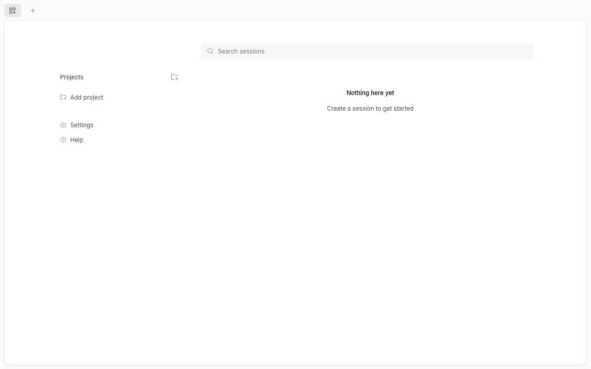

# OpenCode クイックスタート

OpenCodeを初めて使う人のための導入ガイドです。インストールして、無料モデルで開発を始めるところまで案内します。

*図: Web UI版の初期画面（2026-10-16取得）。ここにセッションが並ぶ。*

## 手順

1. [インストール](install.html) — Windows / Macに入れる
2. [初回起動](start.html) — 起動してプロジェクトを開く
3. [無料モデル](free-model.html) — 無料モデルを選ぶ
4. [基本操作](usage.html) — 質問・変更・取り消し
5. [スキル](skills.html) — スキル導入と `/`・`@` の違い
6. [小技](tips.html) — ちょっとしたテクニック
7. [困ったとき](troubleshooting.html) — 注意点と対処

## 表記ルール

このサイトでは、内容の検証状態を区別しています。

| 表記 | 意味 |
| --- | --- |
| ✅ 検証済み | 筆者のmacOS環境で実際に実行して確認した内容 |
| ⚠️ 未検証 | 公式ドキュメントに基づく内容。環境で再確認してください |
| 🔑 要ログイン | アカウント登録やAPIキーが必要な手順 |

検証環境: macOS + OpenCode v2.0.30。このサイトの作業自体が無料モデル（Muse Spark 1.3 Free）で動作確認しています。✅ 検証済み
